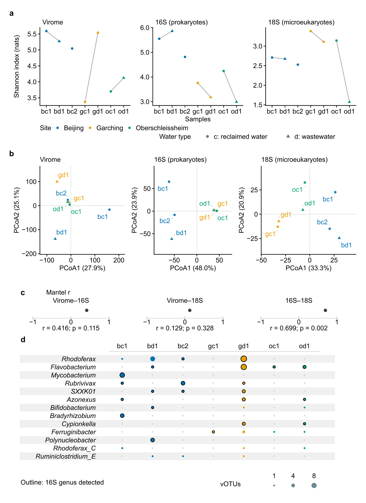
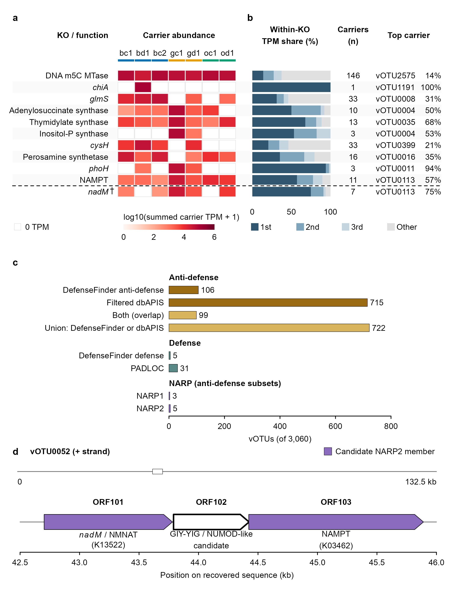
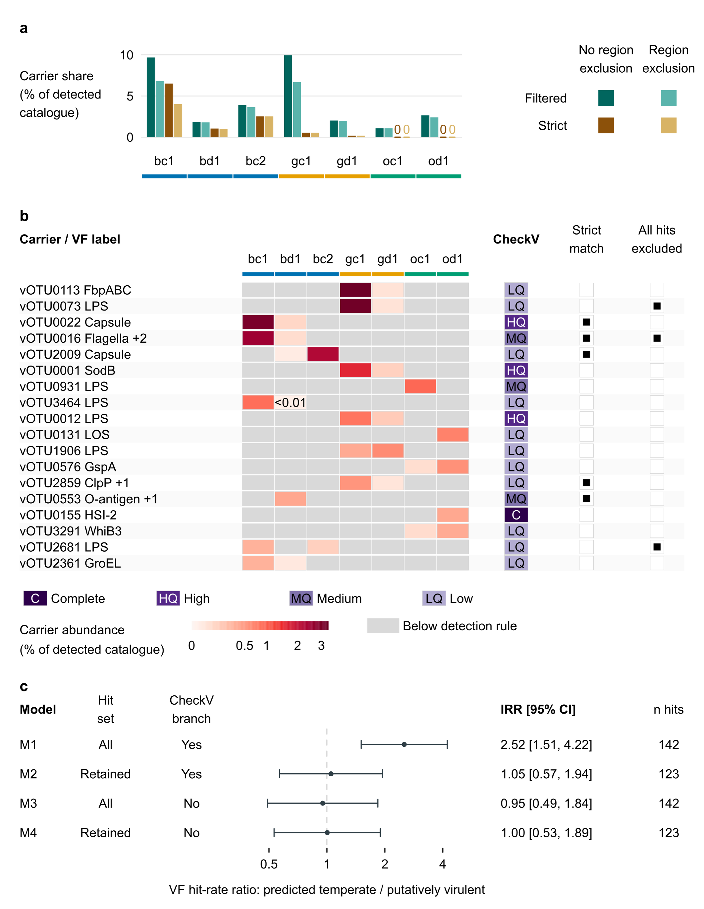
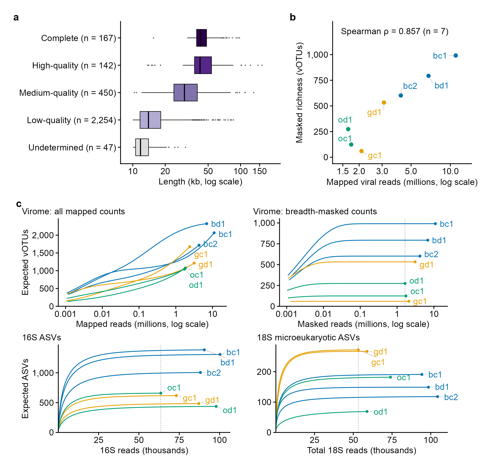
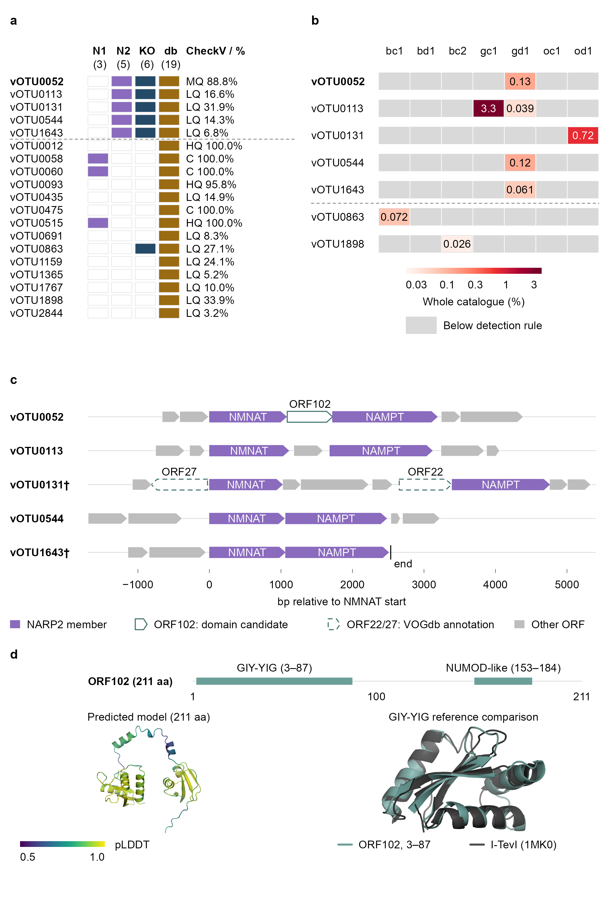
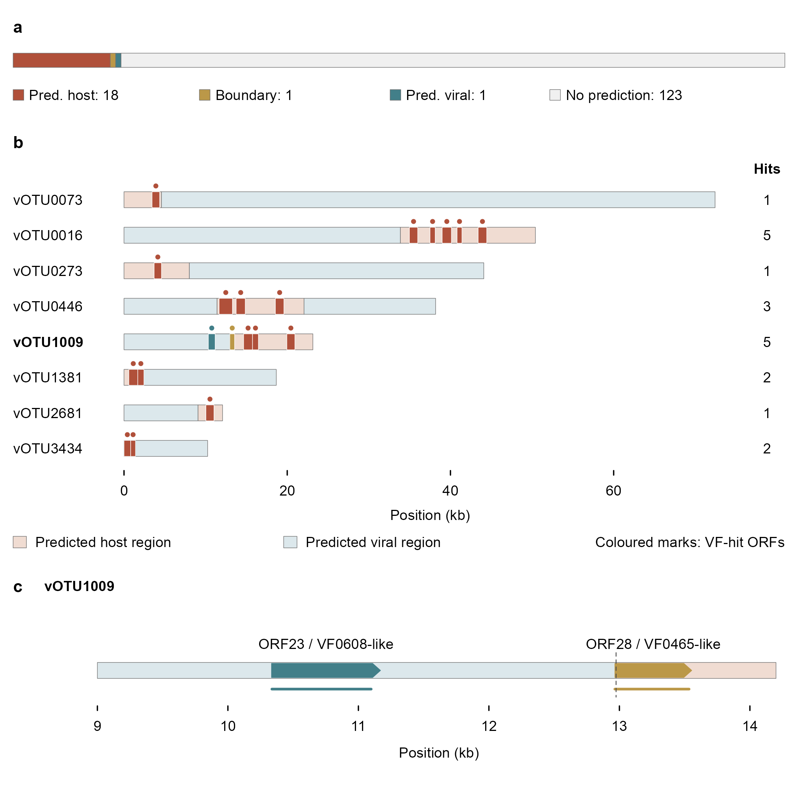

# Figures matched to the BMC clean submission

Authors: Jinlong Ru; Cunli Pan. Authority: **BMC_Microbiology_submission_clean_2026-10-26**. These nine previews match the figures embedded in the author's current main/SI Word files by pixel content. Five main TIFFs also match the clean Figures directory. Source documents were read only; their hashes and image checks are in [the baseline receipt](provenance/bmc-clean-baseline.json).

The historical computational source is v58.2; the retained directory name does not change the current authority.

## Fig. 1

## Fig. 2

## Fig. 3

## Fig. 4

## Fig. 5

## Supplementary Fig. S1

## Supplementary Fig. S2

## Supplementary Fig. S3

## Supplementary Fig. S4

