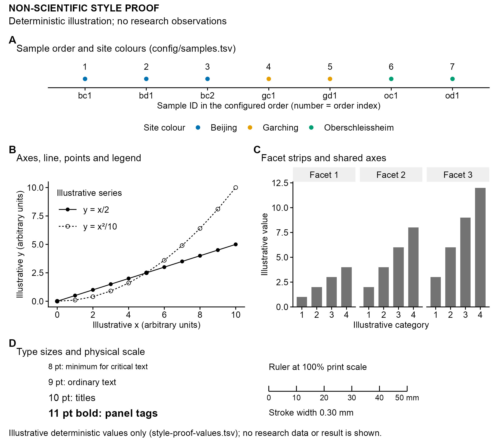

# 090-style-proof
Jinlong Ru, Cunli Pan
2026-10-20

**Updated: 2026-10-20 00:22:46 CEST +0200.**

<!-- RWV_REPORT_SUMMARY_START -->

<section class="rwv-report-summary" aria-label="Run summary">

<h2>

Run summary
</h2>

<strong>Step completed</strong> · 7 output files.

Key files:
<a href="data/090-style-proof/style-proof.pdf">style-proof.pdf</a> ·
<a href="data/090-style-proof/style-proof.png">style-proof.png</a>

No runtime warnings were captured after report initialization.

</section>

<!-- RWV_REPORT_SUMMARY_END -->

Analysis steps, methods and full verification

## Tasks

> [!WARNING]
>
> ### Non-scientific style proof
>
> This deterministic illustration checks shared fonts, type sizes, line
> widths, page dimensions, legends, facets, panel labels, layout and
> PDF/SVG/PNG exports. Values y = x/2, y = x^2/10 and y = k\*x are
> illustrative, not research observations or results.

### Task 1: Read verified inputs

The upstream manifest is accessed through path_source and checked
against the 010 step-record hash. Both configuration files must match
their 010 manifest entries.

| kind     | path                                  | sha256           |
|:---------|:--------------------------------------|:-----------------|
| upstream | 010-input-manifest/input-manifest.tsv | 70ee8c390a17b829 |
| project  | config/style.yml                      | 07c316c563f2f4ae |
| project  | config/samples.tsv                    | d78164d7c020f6f5 |

Inputs verified for this run (sha256 shortened)

| sample_id | sample_order | site             | colour   |
|:----------|-------------:|:-----------------|:---------|
| bc1       |            1 | Beijing          | \#0072B2 |
| bd1       |            2 | Beijing          | \#0072B2 |
| bc2       |            3 | Beijing          | \#0072B2 |
| gc1       |            4 | Garching         | \#E69F00 |
| gd1       |            5 | Garching         | \#E69F00 |
| oc1       |            6 | Oberschleissheim | \#009E73 |
| od1       |            7 | Oberschleissheim | \#009E73 |

Sample dictionary (config/samples.tsv) with the fixed site colours

| role | family | resolved_family | style | postscript_name | path |
|:---|:---|:---|:---|:---|:---|
| text | Arial | Arial | Regular | ArialMT | /System/Library/Fonts/Supplemental/Arial.ttf |
| text-bold | Arial | Arial | Bold | Arial-BoldMT | /System/Library/Fonts/Supplemental/Arial Bold.ttf |

Fonts resolved through systemfonts (no silent substitution)

### Task 2: Deterministic illustrative values

### Task 3: Panels and layout

### Task 4: Export the same figure object and verify it

Probe available graphics devices, then export the same combined figure
object through path_target as PDF, SVG and 300 dpi PNG. Checks cover
page dimensions, embedded fonts, text from every panel, minimum type
size, line widths, the 50 mm scale and white background.

| format | file | device | width_mm | height_mm | probe |
|:---|:---|:---|---:|---:|:---|
| pdf | style-proof.pdf | quartz_pdf | 180 | 160 | cairo_pdf: unable to load shared object ‘/Library/Frameworks/R.framework/Resources/modules//R_X11.so’: dlopen(/Library/Frameworks/R.framework/Resources/modules//R_X11.so, 0x0006): Library not loaded: /opt/X11/lib/libSM.6.dylib Referenced from: \<7ECC4104-EC6A-38FD-9BEA-BFE0B870925C\> /Library/Frameworks/R.framework/Versions/4.5-arm64/Resources/modules/R_X11.so Reason: tried: ‘/opt/X11/lib/libSM.6.dylib’ (no such file), ‘/System/Volumes/Preboot/Cryptexes/OS/opt/X11/lib/libSM.6.dylib’ (no such file), ‘/opt/X11/lib/libSM.6.dylib’ (no such file), ‘/Library/Frameworks/R.framework/Resources/lib/libSM.6.dylib’ (no such file), ‘/Library/Java/JavaVirtualMachines/jdk-11.0.18+10/Contents/Home/lib/server/libSM.6.dylib’ (no such file); quartz_pdf: ok |
| svg | style-proof.svg | svglite | 180 | 160 | svglite: ok |
| png | style-proof.png | ragg::agg_png | 180 | 160 | agg_png: ok |
| tiff | style-proof.tiff | ragg::agg_tiff (LZW) | 180 | 160 | agg_tiff: ok |

Exports of the same assembled object

| format | check | expected | observed | pass |
|:---|:---|:---|:---|:---|
| pdf | pages | 1 | 1 | TRUE |
| pdf | page size (mm) | 180.00 x 160.00 | 180.00 x 160.00 | TRUE |
| pdf | all fonts embedded | TRUE | TRUE | TRUE |
| pdf | embedded fonts are resolved fonts (no substitution) | ArialMT, Arial-BoldMT | Arial-BoldMT, ArialMT | TRUE |
| pdf | text present | NON-SCIENTIFIC STYLE PROOF | found | TRUE |
| pdf | text present | Deterministic illustration; no research observations | found | TRUE |
| pdf | text present | A | found | TRUE |
| pdf | text present | B | found | TRUE |
| pdf | text present | C | found | TRUE |
| pdf | text present | D | found | TRUE |
| pdf | text present | Sample order and site colours (config/samples.tsv) | found | TRUE |
| pdf | text present | Axes, line, points and legend | found | TRUE |
| pdf | text present | Facet strips and shared axes | found | TRUE |
| pdf | text present | Type sizes and physical scale | found | TRUE |
| pdf | text present | 50 mm | found | TRUE |
| svg | page size (mm) | 180.00 x 160.00 | 180.00 x 160.00 | TRUE |
| svg | font families are the resolved fonts | Arial | Arial | TRUE |
| svg | smallest text (pt) | \>= 8 | 8 | TRUE |
| svg | no embedded raster images | 0 | 0 | TRUE |
| svg | text present | NON-SCIENTIFIC STYLE PROOF | found | TRUE |
| svg | text present | Deterministic illustration; no research observations | found | TRUE |
| svg | text present | A | found | TRUE |
| svg | text present | B | found | TRUE |
| svg | text present | C | found | TRUE |
| svg | text present | D | found | TRUE |
| svg | text present | Sample order and site colours (config/samples.tsv) | found | TRUE |
| svg | text present | Axes, line, points and legend | found | TRUE |
| svg | text present | Facet strips and shared axes | found | TRUE |
| svg | text present | Type sizes and physical scale | found | TRUE |
| svg | text present | 50 mm | found | TRUE |
| svg | main stroke width (pt) | 0.85 (0.30 mm) | 0.85 | TRUE |
| svg | ruler length (mm) | 50 | 49.999 | TRUE |
| png | pixels (w x h) | 2126 x 1890 | 2125 x 1889 | TRUE |
| png | resolution (dpi) | 300 | 300.00 | TRUE |
| png | opaque (no transparency) | TRUE | TRUE | TRUE |
| png | white corners | 1 | 1 | TRUE |
| tiff | pixels (w x h) | 4252 x 3780 | 4251 x 3779 | TRUE |
| tiff | resolution (dpi) | 600 | 600.00 x 600.00 | TRUE |
| tiff | LZW compression (code 5) | 5 | 5 | TRUE |
| tiff | RGB without alpha (3 samples per pixel) | 3 | 3 | TRUE |

Export checks (all must pass)

The 300 dpi PNG below is a preview. Vector masters are style-proof.pdf
and style-proof.svg in the same output directory:

### Task 5: Record the run

| file                    |  bytes | sha256           |
|:------------------------|-------:|:-----------------|
| style-proof.pdf         |  53081 | b2082256c1c6cdbe |
| style-proof.svg         |  31880 | 0a08dd5fbb3c4764 |
| style-proof.png         | 220958 | 31d79a3436aa9716 |
| style-proof.tiff        | 548214 | de2238b858b4ed62 |
| style-proof-values.tsv  |   1203 | 8b0b579f8d1126a3 |
| style-proof-export.json |   9287 | c497edf6fbf24b10 |
| session-info.txt        |  13764 | cfb8fa7bf4b4e92f |

Outputs recorded in step-record.json

## Published figure preview

All output files

<ul>
<li><a href="data/090-style-proof/style-proof.pdf">style-proof.pdf</a> (51.8 KB)</li>
<li><a href="data/090-style-proof/style-proof.svg">style-proof.svg</a> (31.1 KB)</li>
<li><a href="data/090-style-proof/style-proof.png">style-proof.png</a> (215.8 KB)</li>
<li><a href="data/090-style-proof/style-proof.tiff">style-proof.tiff</a> (535.4 KB)</li>
<li><a href="data/090-style-proof/style-proof-values.tsv">style-proof-values.tsv</a> (1.2 KB)</li>
<li><a href="data/090-style-proof/style-proof-export.json">style-proof-export.json</a> (9.1 KB)</li>
<li><a href="data/090-style-proof/session-info.txt">session-info.txt</a> (13.4 KB)</li>
</ul>

