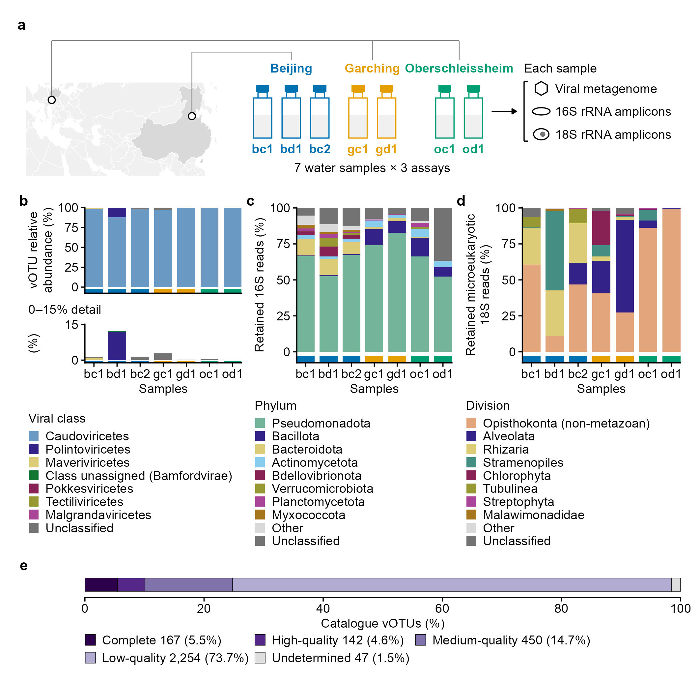

# 110-fig1-design-composition
Jinlong Ru, Cunli Pan
2026-10-20

**Updated: 2026-10-20 00:22:55 CEST +0200.**

<!-- RWV_REPORT_SUMMARY_START -->

<section class="rwv-report-summary" aria-label="Run summary">

<h2>

Run summary
</h2>

<strong>Step completed</strong> · 9 output files.

Saved assertions: 20 passed, 0 failed, 0 unclassified.

Key files:
<a href="data/110-fig1-design-composition/fig1.pdf">fig1.pdf</a> ·
<a href="data/110-fig1-design-composition/fig1.png">fig1.png</a>

No runtime warnings were captured after report initialization.

Full runtime diagnostics (messages and warnings)

<pre>
[message; panel-a]
Spherical geometry (s2) switched off
&#10;</pre>

</section>

<!-- RWV_REPORT_SUMMARY_END -->

Analysis steps, methods and full verification

## Tasks

Draw Figure 1 from verified 020 tables: regional study context, seven
water samples with three sequencing assays each, within-assay
composition and all five CheckV completeness categories for 3,060 vOTUs.
No new statistics are calculated.

### Task 1: Inputs

### Task 2: Panel a: regional study context

Natural Earth 1:50m country boundaries (rnaturalearthdata::countries50;
package CC0, geographic data public domain) use a Lambert equal-area
projection for regional orientation only. config/site-locations.tsv
supplies city/municipality representative coordinates, not recovered
sampling coordinates. Beijing has one regional marker. The two German
municipalities are about 6 km apart and share one marker at their
coordinate mean, linked to both sample groups. The 3/2/2 bottles
indicate sample counts. No waterworks, river, process or flow direction
is inferred.

### Task 3: Panels b-d: within-assay composition

Each composition panel sums to 100% within its own assay/sample and
cannot compare absolute biomass between assays. Caudoviricetes account
for 88-99.9% of viral composition; the additional expanded-axis strip
shows the same non-Caudoviricetes values. Taxon colours are meaningful
only within their own assay.

### Task 4: Panel e: all five CheckV completeness categories

### Task 5: Assemble and export

| format | check | observed | pass |
|:---|:---|:---|:---|
| pdf | pages | 1 | TRUE |
| pdf | page size (mm) | 180.00 x 175.00 | TRUE |
| pdf | all fonts embedded | TRUE | TRUE |
| pdf | embedded fonts are resolved fonts (no substitution) | Arial-BoldMT, ArialMT | TRUE |
| pdf | text present | found | TRUE |
| pdf | text present | found | TRUE |
| pdf | text present | found | TRUE |
| pdf | text present | found | TRUE |
| pdf | text present | found | TRUE |
| pdf | text present | found | TRUE |
| pdf | text present | found | TRUE |
| pdf | text present | found | TRUE |
| pdf | text present | found | TRUE |
| pdf | text present | found | TRUE |
| pdf | text present | found | TRUE |
| pdf | text present | found | TRUE |
| pdf | text present | found | TRUE |
| pdf | text present | found | TRUE |
| pdf | text present | found | TRUE |
| pdf | text present | found | TRUE |
| pdf | text present | found | TRUE |
| pdf | text present | found | TRUE |
| pdf | text present | found | TRUE |
| pdf | text present | found | TRUE |
| pdf | text present | found | TRUE |
| pdf | text present | found | TRUE |
| pdf | text present | found | TRUE |
| pdf | text present | found | TRUE |
| pdf | text present | found | TRUE |
| pdf | text present | found | TRUE |
| pdf | text present | found | TRUE |
| pdf | text present | found | TRUE |
| pdf | text present | found | TRUE |
| pdf | text present | found | TRUE |
| pdf | text present | found | TRUE |
| pdf | text present | found | TRUE |
| pdf | text present | found | TRUE |
| pdf | text present | found | TRUE |
| pdf | text present | found | TRUE |
| pdf | text present | found | TRUE |
| pdf | text present | found | TRUE |
| svg | page size (mm) | 180.00 x 175.00 | TRUE |
| svg | font families are the resolved fonts | Arial | TRUE |
| svg | smallest text (pt) | 9.2 | TRUE |
| svg | no embedded raster images | 0 | TRUE |
| svg | text present | found | TRUE |
| svg | text present | found | TRUE |
| svg | text present | found | TRUE |
| svg | text present | found | TRUE |
| svg | text present | found | TRUE |
| svg | text present | found | TRUE |
| svg | text present | found | TRUE |
| svg | text present | found | TRUE |
| svg | text present | found | TRUE |
| svg | text present | found | TRUE |
| svg | text present | found | TRUE |
| svg | text present | found | TRUE |
| svg | text present | found | TRUE |
| svg | text present | found | TRUE |
| svg | text present | found | TRUE |
| svg | text present | found | TRUE |
| svg | text present | found | TRUE |
| svg | text present | found | TRUE |
| svg | text present | found | TRUE |
| svg | text present | found | TRUE |
| svg | text present | found | TRUE |
| svg | text present | found | TRUE |
| svg | text present | found | TRUE |
| svg | text present | found | TRUE |
| svg | text present | found | TRUE |
| svg | text present | found | TRUE |
| svg | text present | found | TRUE |
| svg | text present | found | TRUE |
| svg | text present | found | TRUE |
| svg | text present | found | TRUE |
| svg | text present | found | TRUE |
| svg | text present | found | TRUE |
| svg | text present | found | TRUE |
| svg | text present | found | TRUE |
| svg | text present | found | TRUE |
| svg | text present | found | TRUE |
| svg | text present | found | TRUE |
| svg | main stroke width (pt) | 0.57, 0.85 | TRUE |
| png | pixels (w x h) | 2125 x 2066 | TRUE |
| png | resolution (dpi) | 300.00 | TRUE |
| png | opaque (no transparency) | TRUE | TRUE |
| png | white corners | 1 | TRUE |
| tiff | pixels (w x h) | 4251 x 4133 | TRUE |
| tiff | resolution (dpi) | 600.00 x 600.00 | TRUE |
| tiff | LZW compression (code 5) | 5 | TRUE |
| tiff | RGB without alpha (3 samples per pixel) | 3 | TRUE |
| pdf | text \>= 2.5 mm from every page edge (mm) | 2.55 | TRUE |
| pdf | no forbidden strings on the page | none | TRUE |

### Task 6: Record plot values, caption and checks

| check | expected | observed | pass |
|:---|:---|:---|:---|
| site-locations.tsv lists exactly the configured sites | Beijing, Garching, Oberschleissheim | Beijing, Garching, Oberschleissheim | TRUE |
| every map coordinate is declared as a representative, not a sampling, coordinate | TRUE | TRUE | TRUE |
| design cells = 7 samples x 3 assays | 21 | 21 | TRUE |
| map highlights exactly the two study countries | China, Germany | China, Germany | TRUE |
| German anchor is the mean of the two municipality coordinates (no display offset) | TRUE | TRUE | TRUE |
| bottles keep the configured sample order and 3/2/2 site membership | bc1, bd1, bc2, gc1, gd1, oc1, od1 | bc1, bd1, bc2, gc1, gd1, oc1, od1 | TRUE |
| bottles per site | 3, 2, 2 | 3, 2, 2 | TRUE |
| largest non-Caudoviricetes share (%) fits the 15% expanded axis | TRUE | TRUE | TRUE |
| virome bars sum to 100% | 100, 100, 100, 100, 100, 100, 100 | 100, 100, 100, 100, 100, 100, 100 | TRUE |
| bact_16s bars sum to 100% | 100, 100, 100, 100, 100, 100, 100 | 100, 100, 100, 100, 100, 100, 100 | TRUE |
| euk_18s_microeuk bars sum to 100% | 100, 100, 100, 100, 100, 100, 100 | 100, 100, 100, 100, 100, 100, 100 | TRUE |
| 16S table includes an archaeal phylum (hence ‘prokaryotic’) | TRUE | TRUE | TRUE |
| definitions.tsv:catalogue_votu | 3060 | 3060 | TRUE |
| definitions.tsv:checkv_complete | 167 | 167 | TRUE |
| definitions.tsv:checkv_high | 142 | 142 | TRUE |
| definitions.tsv:checkv_medium | 450 | 450 | TRUE |
| definitions.tsv:checkv_low | 2254 | 2254 | TRUE |
| definitions.tsv:checkv_undetermined | 47 | 47 | TRUE |
| length range stated in the legend (moved from the panel title) | 10005, 158264 | 10005, 158264 | TRUE |
| plot-values panels equal the figure’s panel tags | A, B, C, D, E | A, B, C, D, E | TRUE |

| file                 |  bytes | sha256           |
|:---------------------|-------:|:-----------------|
| fig1.pdf             | 826492 | 8b469c1c8efa7273 |
| fig1.svg             | 831277 | bea5ce466ebd65b9 |
| fig1.png             | 320335 | 1562f276e3f26106 |
| fig1.tiff            | 991058 | 767ac29304c1f2ce |
| fig1-export.json     |  16331 | c688bb316dafb75a |
| fig1-plot-values.tsv |  15069 | 088eb0b7ac3c4243 |
| fig1-legend.md       |   5686 | e22df6b5f98e3324 |
| fig1-checks.tsv      |   1868 | 558b29ad82cf4934 |
| session-info.txt     |  13776 | 2464f2c67d466000 |

Outputs recorded in step-record.json

## Published figure preview

All output files

<ul>
<li><a href="data/110-fig1-design-composition/fig1.pdf">fig1.pdf</a> (807.1 KB)</li>
<li><a href="data/110-fig1-design-composition/fig1.svg">fig1.svg</a> (811.8 KB)</li>
<li><a href="data/110-fig1-design-composition/fig1.png">fig1.png</a> (312.8 KB)</li>
<li><a href="data/110-fig1-design-composition/fig1.tiff">fig1.tiff</a> (967.8 KB)</li>
<li><a href="data/110-fig1-design-composition/fig1-export.json">fig1-export.json</a> (15.9 KB)</li>
<li><a href="data/110-fig1-design-composition/fig1-plot-values.tsv">fig1-plot-values.tsv</a> (14.7 KB)</li>
<li><a href="data/110-fig1-design-composition/fig1-legend.md">fig1-legend.md</a> (5.6 KB)</li>
<li><a href="data/110-fig1-design-composition/fig1-checks.tsv">fig1-checks.tsv</a> (1.8 KB)</li>
<li><a href="data/110-fig1-design-composition/session-info.txt">session-info.txt</a> (13.5 KB)</li>
</ul>

