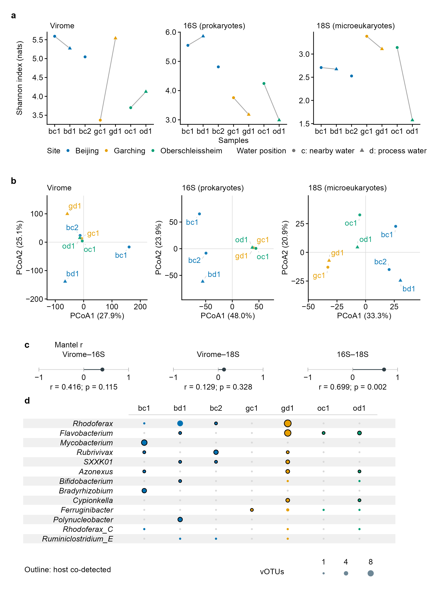

# 120-fig2-community-links
Jinlong Ru, Cunli Pan
2026-10-20

**Updated: 2026-10-20 00:23:06 CEST +0200.**

<!-- RWV_REPORT_SUMMARY_START -->

<section class="rwv-report-summary" aria-label="Run summary">

<h2>

Run summary
</h2>

<strong>Step completed</strong> · 9 output files.

Saved assertions: 34 passed, 0 failed, 0 unclassified.

Key files: <a href="data/120-fig2-community-links/fig2.pdf">fig2.pdf</a>
· <a href="data/120-fig2-community-links/fig2.png">fig2.png</a>

No runtime warnings were captured after report initialization.

</section>

<!-- RWV_REPORT_SUMMARY_END -->

Analysis steps, methods and full verification

## Tasks

Draw Figure 2 from verified 020 tables: seven-sample Shannon, saved
Aitchison PCoA coordinates, all three Mantel correlations and
sample-level detection bubbles for the top ten predicted host genera
including ties (13 genera) by catalogue vOTU count among 200 best iPHoP
records. The 200-record iPHoP and 29-edge strict-CRISPR summaries retain
their separate denominators and four-category checks in the caption. No
ordination, statistical test or group ellipse is newly fitted.

### Task 1: Inputs

### Task 2: Panel a: seven Shannon values per assay

Thin grey lines connect same-site c/d record-label pairs for direction
only; bc2 is unpaired. Points have no error bars because the SD across
100 viral rarefactions is technical rather than biological variation.
Different feature units and rarefaction depths preclude cross-assay
comparison of Shannon magnitudes.

### Task 3: Panel b: saved Aitchison PCoA

Each assay has its own equal-aspect coordinate system. Axis percentages
are read from the saved object and are already percentages.

### Task 4: Panel c: all three Mantel correlations

Display all three Mantel results on a common -1 to 1 axis. Report saved
nominal Spearman p values (999 permutations, seed 42) without
multiple-testing adjustment or selecting the most significant method.
Complete Procrustes/RV results are in Data 1 S09.

### Task 5: Panel d: sample-level detection for the displayed host genera

The four mutually exclusive host categories describe named-genus
visibility and same-sample co-detection, with unresolved genera
separate; they are not validated infection levels. Both iPHoP and CRISPR
use the breadth-masked viral count \> 0 and host-genus 16S count \> 0
rules, using their respective saved genus tables and the
n_codetected_saved/n_codetected_masked fields. The 200 records and 29
edges are different units; CRISPR evidence overlaps the iPHoP records
and is not an independent validation set.

### Task 6: Assemble and export

| format | check | observed | pass |
|:---|:---|:---|:---|
| pdf | pages | 1 | TRUE |
| pdf | page size (mm) | 180.00 x 247.00 | TRUE |
| pdf | all fonts embedded | TRUE | TRUE |
| pdf | embedded fonts are resolved fonts (no substitution) | Arial-BoldMT, Arial-ItalicMT, ArialMT | TRUE |
| pdf | text present | found | TRUE |
| pdf | text present | found | TRUE |
| pdf | text present | found | TRUE |
| pdf | text present | found | TRUE |
| pdf | text present | found | TRUE |
| pdf | text present | found | TRUE |
| pdf | text present | found | TRUE |
| pdf | text present | found | TRUE |
| pdf | text present | found | TRUE |
| pdf | text present | found | TRUE |
| pdf | text present | found | TRUE |
| pdf | text present | found | TRUE |
| pdf | text present | found | TRUE |
| pdf | text present | found | TRUE |
| pdf | text present | found | TRUE |
| pdf | text present | found | TRUE |
| pdf | text present | found | TRUE |
| pdf | text present | found | TRUE |
| pdf | text present | found | TRUE |
| pdf | text present | found | TRUE |
| pdf | text present | found | TRUE |
| pdf | text present | found | TRUE |
| pdf | text present | found | TRUE |
| pdf | text present | found | TRUE |
| pdf | text present | found | TRUE |
| pdf | text present | found | TRUE |
| pdf | text present | found | TRUE |
| pdf | text present | found | TRUE |
| pdf | text present | found | TRUE |
| pdf | text present | found | TRUE |
| pdf | text present | found | TRUE |
| pdf | text present | found | TRUE |
| pdf | text present | found | TRUE |
| pdf | text present | found | TRUE |
| pdf | text present | found | TRUE |
| pdf | text present | found | TRUE |
| pdf | text present | found | TRUE |
| pdf | text present | found | TRUE |
| pdf | text present | found | TRUE |
| pdf | text present | found | TRUE |
| pdf | text present | found | TRUE |
| pdf | text present | found | TRUE |
| pdf | text present | found | TRUE |
| pdf | text present | found | TRUE |
| pdf | text present | found | TRUE |
| pdf | text present | found | TRUE |
| pdf | text present | found | TRUE |
| svg | page size (mm) | 180.00 x 247.00 | TRUE |
| svg | font families are the resolved fonts | Arial | TRUE |
| svg | smallest text (pt) | 9.2 | TRUE |
| svg | no embedded raster images | 0 | TRUE |
| svg | text present | found | TRUE |
| svg | text present | found | TRUE |
| svg | text present | found | TRUE |
| svg | text present | found | TRUE |
| svg | text present | found | TRUE |
| svg | text present | found | TRUE |
| svg | text present | found | TRUE |
| svg | text present | found | TRUE |
| svg | text present | found | TRUE |
| svg | text present | found | TRUE |
| svg | text present | found | TRUE |
| svg | text present | found | TRUE |
| svg | text present | found | TRUE |
| svg | text present | found | TRUE |
| svg | text present | found | TRUE |
| svg | text present | found | TRUE |
| svg | text present | found | TRUE |
| svg | text present | found | TRUE |
| svg | text present | found | TRUE |
| svg | text present | found | TRUE |
| svg | text present | found | TRUE |
| svg | text present | found | TRUE |
| svg | text present | found | TRUE |
| svg | text present | found | TRUE |
| svg | text present | found | TRUE |
| svg | text present | found | TRUE |
| svg | text present | found | TRUE |
| svg | text present | found | TRUE |
| svg | text present | found | TRUE |
| svg | text present | found | TRUE |
| svg | text present | found | TRUE |
| svg | text present | found | TRUE |
| svg | text present | found | TRUE |
| svg | text present | found | TRUE |
| svg | text present | found | TRUE |
| svg | text present | found | TRUE |
| svg | text present | found | TRUE |
| svg | text present | found | TRUE |
| svg | text present | found | TRUE |
| svg | text present | found | TRUE |
| svg | text present | found | TRUE |
| svg | text present | found | TRUE |
| svg | text present | found | TRUE |
| svg | text present | found | TRUE |
| svg | text present | found | TRUE |
| svg | text present | found | TRUE |
| svg | text present | found | TRUE |
| svg | main stroke width (pt) | 0.34, 0.57, 0.85 | TRUE |
| png | pixels (w x h) | 2125 x 2917 | TRUE |
| png | resolution (dpi) | 300.00 | TRUE |
| png | opaque (no transparency) | TRUE | TRUE |
| png | white corners | 1 | TRUE |
| tiff | pixels (w x h) | 4251 x 5834 | TRUE |
| tiff | resolution (dpi) | 600.00 x 600.00 | TRUE |
| tiff | LZW compression (code 5) | 5 | TRUE |
| tiff | RGB without alpha (3 samples per pixel) | 3 | TRUE |
| pdf | text \>= 2.5 mm from every page edge (mm) | 2.55 | TRUE |
| pdf | no forbidden strings on the page | none | TRUE |

### Task 7: Record plot values, caption and checks

| check | expected | observed | pass |
|:---|:---|:---|:---|
| three label pairs per omic | 3, 3, 3 | 3, 3, 3 | TRUE |
| segment ends reproduce saved dirty - clean differences | 0.31100764015, -0.57885197358, -1.25501027299, -0.03438113041, -0.27386215876, -1.56649161160, -0.32026418447, 2.16846777303, 0.42333987137 | 0.31100764015, -0.57885197358, -1.25501027299, -0.03438113041, -0.27386215876, -1.56649161160, -0.32026418447, 2.16846777303, 0.42333987137 | TRUE |
| bc2 has no connecting line | FALSE | FALSE | TRUE |
| PCoA points per panel | 7, 7, 7 | 7, 7, 7 | TRUE |
| Mantel r shown (6 dp) | 0.415584, 0.128571, 0.698701 | 0.415584, 0.128571, 0.698701 | TRUE |
| Mantel p shown | 0.115, 0.328, 0.002 | 0.115, 0.328, 0.002 | TRUE |
| panel c draws the three assay pairs once each | 1, 2, 3 | 1, 2, 3 | TRUE |
| iPHoP visibility classes are the three recorded statuses | TRUE | TRUE | TRUE |
| iPHoP visibility_status agrees with host_in_16s_clean | TRUE | TRUE | TRUE |
| every 16S-visible iPHoP record has a co-detection count (a missing value is not read as 0) | 0 | 0 | TRUE |
| definitions.tsv:iphop_records | 200 | 200 | TRUE |
| the four iPHoP categories partition all records (v45 legend wording) | 200 | 200 | TRUE |
| definitions.tsv:iphop_visible | 127 | 127 | TRUE |
| definitions.tsv:iphop_codetected | 83 | 83 | TRUE |
| definitions.tsv:iphop_visible_no_codetection | 44 | 44 | TRUE |
| definitions.tsv:iphop_not_detected | 70 | 70 | TRUE |
| definitions.tsv:iphop_unresolved | 3 | 3 | TRUE |
| co-detected CRISPR edges are a subset of 16S-visible edges | 0 | 0 | TRUE |
| strict CRISPR edges without a resolved genus (none, so no white segment is drawn) | 0 | 0 | TRUE |
| definitions.tsv:crispr_edges | 29 | 29 | TRUE |
| definitions.tsv:crispr_codetected | 13 | 13 | TRUE |
| definitions.tsv:crispr_visible_no_codetection | 3 | 3 | TRUE |
| definitions.tsv:crispr_codetected_raw | 15 | 15 | TRUE |
| every record and edge falls in exactly one class | 200, 29 | 200, 29 | TRUE |
| strict CRISPR edges meet both score thresholds | TRUE | TRUE | TRUE |
| strict CRISPR edges with zero mismatches (071 funnel) | 10 | 10 | TRUE |
| all strict CRISPR vOTUs are among the 200 iPHoP records | 25 | 25 | TRUE |
| each row is normalised to its own denominator (shares sum to 100%) | 100, 100 | 100, 100 | TRUE |
| resolved best-host records and distinct resolved genera | 197, 129 | 197, 129 | TRUE |
| top 10 + ties: genera, records, display cut (records per genus) | 13, 64, 3 | 13, 64, 3 | TRUE |
| per-sample co-detection rows cover the 200 records x 7 samples | 1400 | 1400 | TRUE |
| panel d cells: 13 genera x 7 samples | 91 | 91 | TRUE |
| a genus is detected in 16S for all or none of its qualifying vOTUs in a sample | TRUE | TRUE | TRUE |
| plot-values panels equal the figure’s panel tags | A, B, C, D | A, B, C, D | TRUE |

| file                 |  bytes | sha256           |
|:---------------------|-------:|:-----------------|
| fig2.pdf             |  82530 | bdb1c7e204d057e8 |
| fig2.svg             |  64899 | 04780d8494bad9e3 |
| fig2.png             | 339645 | 0da3d92a2417e61e |
| fig2.tiff            | 789636 | b176b90d962980de |
| fig2-export.json     |  19664 | 58420d6f8f6bf004 |
| fig2-plot-values.tsv |  14975 | e75efbe3f48818aa |
| fig2-legend.md       |   7728 | 92a01d90dee8352d |
| fig2-checks.tsv      |   2901 | 82639714effb8a9e |
| session-info.txt     |  13773 | 97da165451271b24 |

Outputs recorded in step-record.json

## Published figure preview

All output files

<ul>
<li><a href="data/120-fig2-community-links/fig2.pdf">fig2.pdf</a> (80.6 KB)</li>
<li><a href="data/120-fig2-community-links/fig2.svg">fig2.svg</a> (63.4 KB)</li>
<li><a href="data/120-fig2-community-links/fig2.png">fig2.png</a> (331.7 KB)</li>
<li><a href="data/120-fig2-community-links/fig2.tiff">fig2.tiff</a> (771.1 KB)</li>
<li><a href="data/120-fig2-community-links/fig2-export.json">fig2-export.json</a> (19.2 KB)</li>
<li><a href="data/120-fig2-community-links/fig2-plot-values.tsv">fig2-plot-values.tsv</a> (14.6 KB)</li>
<li><a href="data/120-fig2-community-links/fig2-legend.md">fig2-legend.md</a> (7.5 KB)</li>
<li><a href="data/120-fig2-community-links/fig2-checks.tsv">fig2-checks.tsv</a> (2.8 KB)</li>
<li><a href="data/120-fig2-community-links/session-info.txt">session-info.txt</a> (13.5 KB)</li>
</ul>

