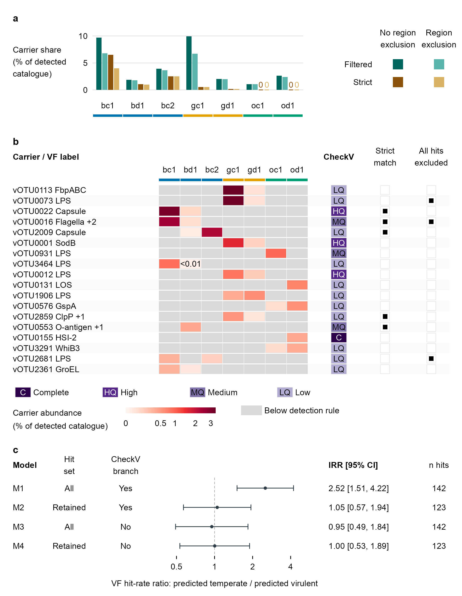

# 140-fig4-vf-context
Jinlong Ru, Cunli Pan
2026-10-20

**Updated: 2026-10-20 00:23:26 CEST +0200.**

<!-- RWV_REPORT_SUMMARY_START -->

<section class="rwv-report-summary" aria-label="Run summary">

<h2>

Run summary
</h2>

<strong>Step completed</strong> · 9 output files.

Saved assertions: 35 passed, 0 failed, 0 unclassified.

Key files: <a href="data/140-fig4-vf-context/fig4.pdf">fig4.pdf</a> ·
<a href="data/140-fig4-vf-context/fig4.png">fig4.png</a>

No runtime warnings were captured after report initialization.

</section>

<!-- RWV_REPORT_SUMMARY_END -->

Analysis steps, methods and full verification

## Tasks

Draw Figure 4 from verified 040 tables: seven-sample candidate-carrier
shares under four annotation definitions, profiles of the 18 displayed
carriers and four lifestyle-sensitivity models. Supplementary Figure 4a
shows the localization scope for 143 catalogue hits; 4b shows
coordinates on eight carriers and 4c the vOTU1009 zoom. Full settings
and interpretation limits are in the caption and Supplementary Note 3.
Saved scientific values are retained; no remapping, refitting or new
test is performed.

### Task 1: Inputs

### Task 1b: Panel a: candidate-carrier shares across seven samples

Panel a first shows total candidate-carrier shares, followed by selected
carrier profiles and model sensitivity. The four bars represent
annotation-definition sensitivity, not replicates or treatment stages.
Zero values remain visible; the former supplementary copy is not
repeated.

### Task 2: Panel b: sample profiles of displayed carriers

Retain all 126 saved cells and their selection, detection and
eligibility rules. The 18 displayed rows are a subset of 114 carriers;
their column sums are not the complete shares in panel a. Colours and
catalogue-wide percentage denominators are unchanged.

### Task 3: Panel c: four dependent lifestyle-sensitivity estimates

All four estimates use the same 3,013 vOTUs and are dependent
sensitivity estimates, not independent replicates. No pooled estimate is
drawn.

### Task 4: Assemble and export

| format | check | observed | pass |
|:---|:---|:---|:---|
| pdf | pages | 1 | TRUE |
| pdf | page size (mm) | 180.00 x 232.00 | TRUE |
| pdf | all fonts embedded | TRUE | TRUE |
| pdf | embedded fonts are resolved fonts (no substitution) | Arial-BoldMT, ArialMT | TRUE |
| pdf | text present | found | TRUE |
| pdf | text present | found | TRUE |
| pdf | text present | found | TRUE |
| pdf | text present | found | TRUE |
| pdf | text present | found | TRUE |
| pdf | text present | found | TRUE |
| pdf | text present | found | TRUE |
| pdf | text present | found | TRUE |
| pdf | text present | found | TRUE |
| pdf | text present | found | TRUE |
| pdf | text present | found | TRUE |
| pdf | text present | found | TRUE |
| pdf | text present | found | TRUE |
| pdf | text present | found | TRUE |
| pdf | text present | found | TRUE |
| pdf | text present | found | TRUE |
| pdf | text present | found | TRUE |
| pdf | text present | found | TRUE |
| pdf | text present | found | TRUE |
| pdf | text present | found | TRUE |
| pdf | text present | found | TRUE |
| pdf | text present | found | TRUE |
| pdf | text present | found | TRUE |
| pdf | text present | found | TRUE |
| pdf | text present | found | TRUE |
| pdf | text present | found | TRUE |
| pdf | text present | found | TRUE |
| pdf | text present | found | TRUE |
| pdf | text present | found | TRUE |
| pdf | text present | found | TRUE |
| pdf | text present | found | TRUE |
| pdf | text present | found | TRUE |
| pdf | text present | found | TRUE |
| pdf | text present | found | TRUE |
| pdf | text present | found | TRUE |
| pdf | text present | found | TRUE |
| pdf | text present | found | TRUE |
| pdf | text present | found | TRUE |
| pdf | text present | found | TRUE |
| pdf | text present | found | TRUE |
| pdf | text present | found | TRUE |
| pdf | text present | found | TRUE |
| pdf | text present | found | TRUE |
| pdf | text present | found | TRUE |
| pdf | text present | found | TRUE |
| pdf | text present | found | TRUE |
| pdf | text present | found | TRUE |
| pdf | text present | found | TRUE |
| pdf | text present | found | TRUE |
| svg | page size (mm) | 180.00 x 232.00 | TRUE |
| svg | font families are the resolved fonts | Arial | TRUE |
| svg | smallest text (pt) | 9.2 | TRUE |
| svg | no embedded raster images | 0 | TRUE |
| svg | text present | found | TRUE |
| svg | text present | found | TRUE |
| svg | text present | found | TRUE |
| svg | text present | found | TRUE |
| svg | text present | found | TRUE |
| svg | text present | found | TRUE |
| svg | text present | found | TRUE |
| svg | text present | found | TRUE |
| svg | text present | found | TRUE |
| svg | text present | found | TRUE |
| svg | text present | found | TRUE |
| svg | text present | found | TRUE |
| svg | text present | found | TRUE |
| svg | text present | found | TRUE |
| svg | text present | found | TRUE |
| svg | text present | found | TRUE |
| svg | text present | found | TRUE |
| svg | text present | found | TRUE |
| svg | text present | found | TRUE |
| svg | text present | found | TRUE |
| svg | text present | found | TRUE |
| svg | text present | found | TRUE |
| svg | text present | found | TRUE |
| svg | text present | found | TRUE |
| svg | text present | found | TRUE |
| svg | text present | found | TRUE |
| svg | text present | found | TRUE |
| svg | text present | found | TRUE |
| svg | text present | found | TRUE |
| svg | text present | found | TRUE |
| svg | text present | found | TRUE |
| svg | text present | found | TRUE |
| svg | text present | found | TRUE |
| svg | text present | found | TRUE |
| svg | text present | found | TRUE |
| svg | text present | found | TRUE |
| svg | text present | found | TRUE |
| svg | text present | found | TRUE |
| svg | text present | found | TRUE |
| svg | text present | found | TRUE |
| svg | text present | found | TRUE |
| svg | text present | found | TRUE |
| svg | text present | found | TRUE |
| svg | text present | found | TRUE |
| svg | text present | found | TRUE |
| svg | text present | found | TRUE |
| svg | text present | found | TRUE |
| svg | text present | found | TRUE |
| svg | text present | found | TRUE |
| svg | main stroke width (pt) | 0.57, 0.85 | TRUE |
| png | pixels (w x h) | 2125 x 2740 | TRUE |
| png | resolution (dpi) | 300.00 | TRUE |
| png | opaque (no transparency) | TRUE | TRUE |
| png | white corners | 1 | TRUE |
| tiff | pixels (w x h) | 4251 x 5480 | TRUE |
| tiff | resolution (dpi) | 600.00 x 600.00 | TRUE |
| tiff | LZW compression (code 5) | 5 | TRUE |
| tiff | RGB without alpha (3 samples per pixel) | 3 | TRUE |
| pdf | text \>= 2.5 mm from every page edge (mm) | 2.55 | TRUE |
| pdf | no forbidden strings on the page | none | TRUE |

### Task 5: Record all-panel plot values, caption and checks

| check | expected | observed | pass |
|:---|:---|:---|:---|
| full catalogue localization scope | 18, 1, 1, 123 | 18, 1, 1, 123 | TRUE |
| full catalogue filtered hits and carriers | 143, 114 | 143, 114 | TRUE |
| catalogue-to-model single hit bridge | TRUE | TRUE | TRUE |
| panel B ranks convert to exactly 1:18 | TRUE | TRUE | TRUE |
| panel B draws two independent qualification columns | 2 | 2 | TRUE |
| panel B vOTU0016 carries both marks at once | 2 | 2 | TRUE |
| definitions.tsv:vf_model_n | 3013 | 3013 | TRUE |
| saved IRR (3 dp) | 2.521, 1.050, 0.951, 1.003 | 2.521, 1.050, 0.951, 1.003 | TRUE |
| definitions.tsv:vf_model_hits_all | 142 | 142 | TRUE |
| definitions.tsv:vf_model_hits_viral | 123 | 123 | TRUE |
| panel C labels state the saved region and lifestyle choices | TRUE | TRUE | TRUE |
| panel C first row retains the CheckV provirus branch | TRUE | TRUE | TRUE |
| page size of the adopted layout (mm) | 180, 232 | 180, 232 | TRUE |
| panel A bars (7 samples x 4 definitions) | 28 | 28 | TRUE |
| panel A zero bars (strict and strict+region in oc1 and od1) | 4 | 4 | TRUE |
| panel A filtered range (%), 2 dp | 1.08, 9.95 | 1.08, 9.95 | TRUE |
| panel B mark heads spell the full names | Strict match, All hits excluded | Strict match, All hits excluded | TRUE |
| panel B rows | 18 | 18 | TRUE |
| panel B mark strip rows match the heatmap rows | TRUE | TRUE | TRUE |
| panel B top row is the highest-ranked carrier | vOTU0113 | vOTU0113 | TRUE |
| panel B first five rows follow the numeric rank | TRUE | TRUE | TRUE |
| panel B cells | 126 | 126 | TRUE |
| panel B shows no imputed zero for undetected cells | 0 | 0 | TRUE |
| panel B drawing rows equal the heatmap rows (top to bottom) | vOTU0113, vOTU0073, vOTU0022, vOTU0016, vOTU2009, … (18 values) | vOTU0113, vOTU0073, vOTU0022, vOTU0016, vOTU2009, … (18 values) | TRUE |
| sample order of panels a and b | bc1, bd1, bc2, gc1, gd1, oc1, od1 | bc1, bd1, bc2, gc1, gd1, oc1, od1 | TRUE |
| panel b CheckV classes are among the four drawn in the key | TRUE | TRUE | TRUE |
| panel b region info: 3 rows with a prediction, 15 without | 3, 15 | 3, 15 | TRUE |
| panel b region info rows are not mixed (all or none of a row’s filtered hits predicted) | TRUE | TRUE | TRUE |
| panel B grey below-detection tiles / detected tiles (v50, no dashes) | 94, 32 | 94, 32 | TRUE |
| panel B detected tiles below 0.01% keep their text label | 1 | 1 | TRUE |
| panel B region prediction rows equal the All hits excluded rows in the displayed selection | vOTU0073, vOTU0016, vOTU2681 | vOTU0073, vOTU0016, vOTU2681 | TRUE |
| panel B no row has a region prediction without the exclusion mark, or vice versa | 0 | 0 | TRUE |
| plot-values panels equal the figure tags | A, B, C | A, B, C | TRUE |
| plot-values panel B has every heatmap cell | 126 | 126 | TRUE |
| all four model intervals recorded | TRUE | TRUE | TRUE |

| file                 |   bytes | sha256           |
|:---------------------|--------:|:-----------------|
| fig4.pdf             |   62553 | f0ab2e85391407a3 |
| fig4.svg             |   83623 | f2fc7fc203b82b67 |
| fig4.png             |  318283 | 7fa9f4aa07a7fc10 |
| fig4.tiff            | 1050966 | 40e0958d0be6e5ff |
| fig4-export.json     |   19955 | eb0645635a1c4351 |
| fig4-plot-values.tsv |   18756 | 0952c01099a55fd7 |
| fig4-legend.md       |    8066 | ce6510692bbebb38 |
| fig4-checks.tsv      |    3068 | e5f671b95eac6235 |
| session-info.txt     |   13698 | 815a4d6826ea50fe |

Outputs recorded in step-record.json

## Published figure preview

All output files

<ul>
<li><a href="data/140-fig4-vf-context/fig4.pdf">fig4.pdf</a> (61.1 KB)</li>
<li><a href="data/140-fig4-vf-context/fig4.svg">fig4.svg</a> (81.7 KB)</li>
<li><a href="data/140-fig4-vf-context/fig4.png">fig4.png</a> (310.8 KB)</li>
<li><a href="data/140-fig4-vf-context/fig4.tiff">fig4.tiff</a> (1026.3 KB)</li>
<li><a href="data/140-fig4-vf-context/fig4-export.json">fig4-export.json</a> (19.5 KB)</li>
<li><a href="data/140-fig4-vf-context/fig4-plot-values.tsv">fig4-plot-values.tsv</a> (18.3 KB)</li>
<li><a href="data/140-fig4-vf-context/fig4-legend.md">fig4-legend.md</a> (7.9 KB)</li>
<li><a href="data/140-fig4-vf-context/fig4-checks.tsv">fig4-checks.tsv</a> (3 KB)</li>
<li><a href="data/140-fig4-vf-context/session-info.txt">session-info.txt</a> (13.4 KB)</li>
</ul>

