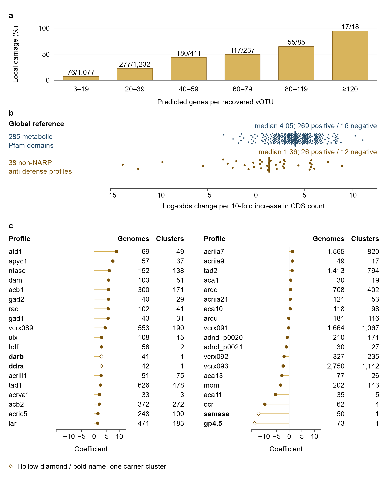

# 150-fig5-global-reference
Jinlong Ru, Cunli Pan
2026-10-20

**Updated: 2026-10-20 00:23:35 CEST +0200.**

<!-- RWV_REPORT_SUMMARY_START -->

<section class="rwv-report-summary" aria-label="Run summary">

<h2>

Run summary
</h2>

<strong>Step completed</strong> · 9 output files.

Saved assertions: 11 passed, 0 failed, 0 unclassified.

Key files:
<a href="data/150-fig5-global-reference/fig5.pdf">fig5.pdf</a> ·
<a href="data/150-fig5-global-reference/fig5.png">fig5.png</a>

No runtime warnings were captured after report initialization.

</section>

<!-- RWV_REPORT_SUMMARY_END -->

Analysis steps, methods and full verification

## Tasks

Figure 5 separates local catalogue carriage proportions in
recovered-sequence gene-count bins (a) from per-feature results in a
separate global reference catalogue (b,c). The two parts have no shared
data axis, shared Venn diagram or global-validation arrow. Both global
feature sets use the same reference catalogue; panel c checks support
for the same 38 profiles and is not an independent replication.

### Task 1: Inputs

### Task 2: Panel a: six local catalogue bins

### Task 3: Panel b: all global per-feature coefficients

### Task 4: Panel c: coefficients, carrier genomes and gene-sharing clusters for 38 profiles

### Task 5: Assemble and export

| format | check | observed | pass |
|:---|:---|:---|:---|
| pdf | pages | 1 | TRUE |
| pdf | page size (mm) | 180.00 x 226.00 | TRUE |
| pdf | all fonts embedded | TRUE | TRUE |
| pdf | embedded fonts are resolved fonts (no substitution) | Arial-BoldMT, ArialMT | TRUE |
| pdf | text present | found | TRUE |
| pdf | text present | found | TRUE |
| pdf | text present | found | TRUE |
| pdf | text present | found | TRUE |
| pdf | text present | found | TRUE |
| pdf | text present | found | TRUE |
| pdf | text present | found | TRUE |
| pdf | text present | found | TRUE |
| pdf | text present | found | TRUE |
| pdf | text present | found | TRUE |
| pdf | text present | found | TRUE |
| pdf | text present | found | TRUE |
| pdf | text present | found | TRUE |
| pdf | text present | found | TRUE |
| pdf | text present | found | TRUE |
| pdf | text present | found | TRUE |
| pdf | text present | found | TRUE |
| pdf | text present | found | TRUE |
| pdf | text present | found | TRUE |
| pdf | text present | found | TRUE |
| pdf | text present | found | TRUE |
| svg | page size (mm) | 180.00 x 226.00 | TRUE |
| svg | font families are the resolved fonts | Arial | TRUE |
| svg | smallest text (pt) | 9.2 | TRUE |
| svg | no embedded raster images | 0 | TRUE |
| svg | text present | found | TRUE |
| svg | text present | found | TRUE |
| svg | text present | found | TRUE |
| svg | text present | found | TRUE |
| svg | text present | found | TRUE |
| svg | text present | found | TRUE |
| svg | text present | found | TRUE |
| svg | text present | found | TRUE |
| svg | text present | found | TRUE |
| svg | text present | found | TRUE |
| svg | text present | found | TRUE |
| svg | text present | found | TRUE |
| svg | text present | found | TRUE |
| svg | text present | found | TRUE |
| svg | text present | found | TRUE |
| svg | text present | found | TRUE |
| svg | text present | found | TRUE |
| svg | text present | found | TRUE |
| svg | text present | found | TRUE |
| svg | text present | found | TRUE |
| svg | text present | found | TRUE |
| svg | main stroke width (pt) | 0.57, 0.85, 1.70 | TRUE |
| png | pixels (w x h) | 2125 x 2669 | TRUE |
| png | resolution (dpi) | 300.00 | TRUE |
| png | opaque (no transparency) | TRUE | TRUE |
| png | white corners | 1 | TRUE |
| tiff | pixels (w x h) | 4251 x 5338 | TRUE |
| tiff | resolution (dpi) | 600.00 x 600.00 | TRUE |
| tiff | LZW compression (code 5) | 5 | TRUE |
| tiff | RGB without alpha (3 samples per pixel) | 3 | TRUE |
| pdf | text \>= 2.5 mm from every page edge (mm) | 3.88 | TRUE |
| pdf | no forbidden strings on the page | none | TRUE |

### Task 6: Record plot values, caption and checks

| check | expected | observed | pass |
|:---|:---|:---|:---|
| definitions.tsv:catalogue_votu | 3060 | 3060 | TRUE |
| definitions.tsv:antidefense_union | 722 | 722 | TRUE |
| highest bin 17 / 18 | 17, 18 | 17, 18 | TRUE |
| definitions.tsv:global_metab | 285 | 285 | TRUE |
| definitions.tsv:global_adf | 38 | 38 | TRUE |
| group medians (6 dp) | 1.356948, 4.048350 | 1.356948, 4.048350 | TRUE |
| definitions.tsv:global_adf | 38 | 38 | TRUE |
| definitions.tsv:global_single_cluster | 4 | 4 | TRUE |
| page size of the adopted layout (mm) | 180, 226 | 180, 226 | TRUE |
| every coefficient lies on the -15 to 12.5 axis | TRUE | TRUE | TRUE |
| every coefficient lies inside the panel C axis | TRUE | TRUE | TRUE |

| file                 |  bytes | sha256           |
|:---------------------|-------:|:-----------------|
| fig5.pdf             |  82183 | f474dcfd1b5c5d45 |
| fig5.svg             |  73308 | fb61cd5e50a81a87 |
| fig5.png             | 335684 | 6e0772b52380c754 |
| fig5.tiff            | 765424 | 98342c569e7c51a2 |
| fig5-export.json     |  11976 | b4c4208f205952e2 |
| fig5-plot-values.tsv |  44524 | e50c31306843257d |
| fig5-legend.md       |   4274 | 2bcd2c37435e1730 |
| fig5-checks.tsv      |    786 | 35da8ab31ea7236a |
| session-info.txt     |  13704 | 23550f3f12c2f766 |

Outputs recorded in step-record.json

## Published figure preview

All output files

<ul>
<li><a href="data/150-fig5-global-reference/fig5.pdf">fig5.pdf</a> (80.3 KB)</li>
<li><a href="data/150-fig5-global-reference/fig5.svg">fig5.svg</a> (71.6 KB)</li>
<li><a href="data/150-fig5-global-reference/fig5.png">fig5.png</a> (327.8 KB)</li>
<li><a href="data/150-fig5-global-reference/fig5.tiff">fig5.tiff</a> (747.5 KB)</li>
<li><a href="data/150-fig5-global-reference/fig5-export.json">fig5-export.json</a> (11.7 KB)</li>
<li><a href="data/150-fig5-global-reference/fig5-plot-values.tsv">fig5-plot-values.tsv</a> (43.5 KB)</li>
<li><a href="data/150-fig5-global-reference/fig5-legend.md">fig5-legend.md</a> (4.2 KB)</li>
<li><a href="data/150-fig5-global-reference/fig5-checks.tsv">fig5-checks.tsv</a> (0.8 KB)</li>
<li><a href="data/150-fig5-global-reference/session-info.txt">session-info.txt</a> (13.4 KB)</li>
</ul>

