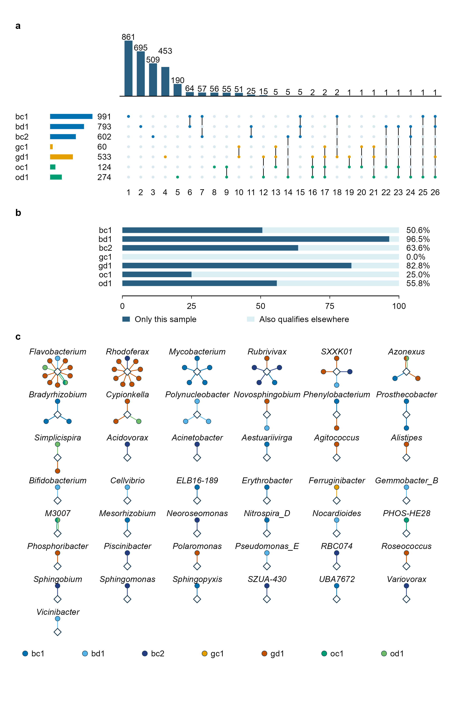

# 210-sfig1-qc-community
Jinlong Ru, Cunli Pan
2026-10-20

**Updated: 2026-10-20 00:23:43 CEST +0200.**

<!-- RWV_REPORT_SUMMARY_START -->

<section class="rwv-report-summary" aria-label="Run summary">

<h2>

Run summary
</h2>

<strong>Step completed</strong> · 18 output files.

Saved assertions: 40 passed, 0 failed, 0 unclassified.

Key files: <a href="data/210-sfig1-qc-community/sfig1.pdf">sfig1.pdf</a>
· <a href="data/210-sfig1-qc-community/sfig1.png">sfig1.png</a> ·
<a href="data/210-sfig1-qc-community/sfig2.pdf">sfig2.pdf</a> ·
<a href="data/210-sfig1-qc-community/sfig2.png">sfig2.png</a>

No runtime warnings were captured after report initialization.

</section>

<!-- RWV_REPORT_SUMMARY_END -->

Analysis steps, methods and full verification

## Tasks

This step exports Supplementary Figures 1 and 2. S1 contains
sequence-length/CheckV quality and detection-depth diagnostics,
including within-table read-subsampling curves. S2 contains qualified
detection patterns, abundance contributions and 83 best-host-genus links
co-detected in at least one sample. Counts are descriptive; no model,
test or threshold is added. Complete PERMANOVA, dispersion and
cross-assay results are retained in Data 1 S10, S11 and S09.

### Task 1: Inputs

### Task 2: S1a: representative sequence lengths for all quality categories

### Task 3: S1c: within-table read-subsampling curves

The curves use Hurlbert analytic expectations calculated in 020,
interpolated only up to each sample’s observed depth. Viral curves show
unmasked counts and counts after the fixed full-depth breadth mask;
amplicons retain their own processing. Curves characterize detection
within the retained feature tables, not assembly/mapping completeness or
full environmental community recovery.

### Task 4: S1b: masked richness and mapped viral reads

The saved Spearman rho = 0.857 (n = 7) relates richness to mapped reads,
not Shannon. It is not recalculated here.

### Task 5: Location of former statistical-summary panels

The former figure panels for PERMANOVA/dispersion and cross-assay
statistics are retained in Data 1 S10, S11 and S09, with worksheet notes
supplied by 320.

### Task 7: Assemble and export S1

| format | check | observed | pass |
|:---|:---|:---|:---|
| pdf | pages | 1 | TRUE |
| pdf | page size (mm) | 180.00 x 175.00 | TRUE |
| pdf | all fonts embedded | TRUE | TRUE |
| pdf | embedded fonts are resolved fonts (no substitution) | Arial-BoldMT, ArialMT | TRUE |
| pdf | text present | found | TRUE |
| pdf | text present | found | TRUE |
| pdf | text present | found | TRUE |
| pdf | text present | found | TRUE |
| pdf | text present | found | TRUE |
| pdf | text present | found | TRUE |
| pdf | text present | found | TRUE |
| pdf | text present | found | TRUE |
| pdf | text present | found | TRUE |
| pdf | text present | found | TRUE |
| pdf | text present | found | TRUE |
| pdf | text present | found | TRUE |
| pdf | text present | found | TRUE |
| pdf | text present | found | TRUE |
| pdf | text present | found | TRUE |
| pdf | text present | found | TRUE |
| pdf | text present | found | TRUE |
| pdf | text present | found | TRUE |
| pdf | text present | found | TRUE |
| pdf | text present | found | TRUE |
| pdf | text present | found | TRUE |
| pdf | text present | found | TRUE |
| pdf | text present | found | TRUE |
| pdf | text present | found | TRUE |
| pdf | text present | found | TRUE |
| pdf | text present | found | TRUE |
| svg | page size (mm) | 180.00 x 175.00 | TRUE |
| svg | font families are the resolved fonts | Arial | TRUE |
| svg | smallest text (pt) | 9.2 | TRUE |
| svg | no embedded raster images | 0 | TRUE |
| svg | text present | found | TRUE |
| svg | text present | found | TRUE |
| svg | text present | found | TRUE |
| svg | text present | found | TRUE |
| svg | text present | found | TRUE |
| svg | text present | found | TRUE |
| svg | text present | found | TRUE |
| svg | text present | found | TRUE |
| svg | text present | found | TRUE |
| svg | text present | found | TRUE |
| svg | text present | found | TRUE |
| svg | text present | found | TRUE |
| svg | text present | found | TRUE |
| svg | text present | found | TRUE |
| svg | text present | found | TRUE |
| svg | text present | found | TRUE |
| svg | text present | found | TRUE |
| svg | text present | found | TRUE |
| svg | text present | found | TRUE |
| svg | text present | found | TRUE |
| svg | text present | found | TRUE |
| svg | text present | found | TRUE |
| svg | text present | found | TRUE |
| svg | text present | found | TRUE |
| svg | text present | found | TRUE |
| svg | text present | found | TRUE |
| svg | main stroke width (pt) | 0.34, 0.57, 0.85, 1.13 | TRUE |
| png | pixels (w x h) | 2125 x 2066 | TRUE |
| png | resolution (dpi) | 300.00 | TRUE |
| png | opaque (no transparency) | TRUE | TRUE |
| png | white corners | 1 | TRUE |
| tiff | pixels (w x h) | 4251 x 4133 | TRUE |
| tiff | resolution (dpi) | 600.00 x 600.00 | TRUE |
| tiff | LZW compression (code 5) | 5 | TRUE |
| tiff | RGB without alpha (3 samples per pixel) | 3 | TRUE |
| pdf | text \>= 2.5 mm from every page edge (mm) | 3.26 | TRUE |
| pdf | no forbidden strings on the page | none | TRUE |

### Task 7b: S2: sharing, abundance contributions and 83 co-detected host links

S2 shows shared members, catalogue abundance contributions and 83
best-host-genus links with at least one same-sample co-detection.
R/sfig-sharing-hosts.R draws one grid object from formal 020 tables;
rwv_figure_export exports four formats. These are counts of saved rows,
not an inferred correlation network. Thresholds and models are
unchanged; colours are registered under sample_codetection and sharing.

| format | check | observed | pass |
|:---|:---|:---|:---|
| pdf | pages | 1 | TRUE |
| pdf | page size (mm) | 180.00 x 274.00 | TRUE |
| pdf | all fonts embedded | TRUE | TRUE |
| pdf | embedded fonts are resolved fonts (no substitution) | Arial-BoldMT, Arial-ItalicMT, ArialMT | TRUE |
| pdf | text present | found | TRUE |
| pdf | text present | found | TRUE |
| pdf | text present | found | TRUE |
| pdf | text present | found | TRUE |
| pdf | text present | found | TRUE |
| pdf | text present | found | TRUE |
| pdf | text present | found | TRUE |
| pdf | text present | found | TRUE |
| pdf | text present | found | TRUE |
| pdf | text present | found | TRUE |
| pdf | text present | found | TRUE |
| pdf | text present | found | TRUE |
| pdf | text present | found | TRUE |
| pdf | text present | found | TRUE |
| pdf | text present | found | TRUE |
| pdf | text present | found | TRUE |
| pdf | text present | found | TRUE |
| pdf | text present | found | TRUE |
| pdf | text present | found | TRUE |
| pdf | text present | found | TRUE |
| pdf | text present | found | TRUE |
| pdf | text present | found | TRUE |
| pdf | text present | found | TRUE |
| pdf | text present | found | TRUE |
| pdf | text present | found | TRUE |
| pdf | text present | found | TRUE |
| pdf | text present | found | TRUE |
| pdf | text present | found | TRUE |
| pdf | text present | found | TRUE |
| pdf | text present | found | TRUE |
| pdf | text present | found | TRUE |
| pdf | text present | found | TRUE |
| pdf | text present | found | TRUE |
| pdf | text present | found | TRUE |
| pdf | text present | found | TRUE |
| pdf | text present | found | TRUE |
| pdf | text present | found | TRUE |
| pdf | text present | found | TRUE |
| pdf | text present | found | TRUE |
| pdf | text present | found | TRUE |
| pdf | text present | found | TRUE |
| pdf | text present | found | TRUE |
| pdf | text present | found | TRUE |
| pdf | text present | found | TRUE |
| pdf | text present | found | TRUE |
| pdf | text present | found | TRUE |
| pdf | text present | found | TRUE |
| pdf | text present | found | TRUE |
| pdf | text present | found | TRUE |
| pdf | text present | found | TRUE |
| pdf | text present | found | TRUE |
| pdf | text present | found | TRUE |
| pdf | text present | found | TRUE |
| pdf | text present | found | TRUE |
| svg | page size (mm) | 180.00 x 274.00 | TRUE |
| svg | font families are the resolved fonts | Arial | TRUE |
| svg | smallest text (pt) | 9.2 | TRUE |
| svg | no embedded raster images | 0 | TRUE |
| svg | text present | found | TRUE |
| svg | text present | found | TRUE |
| svg | text present | found | TRUE |
| svg | text present | found | TRUE |
| svg | text present | found | TRUE |
| svg | text present | found | TRUE |
| svg | text present | found | TRUE |
| svg | text present | found | TRUE |
| svg | text present | found | TRUE |
| svg | text present | found | TRUE |
| svg | text present | found | TRUE |
| svg | text present | found | TRUE |
| svg | text present | found | TRUE |
| svg | text present | found | TRUE |
| svg | text present | found | TRUE |
| svg | text present | found | TRUE |
| svg | text present | found | TRUE |
| svg | text present | found | TRUE |
| svg | text present | found | TRUE |
| svg | text present | found | TRUE |
| svg | text present | found | TRUE |
| svg | text present | found | TRUE |
| svg | text present | found | TRUE |
| svg | text present | found | TRUE |
| svg | text present | found | TRUE |
| svg | text present | found | TRUE |
| svg | text present | found | TRUE |
| svg | text present | found | TRUE |
| svg | text present | found | TRUE |
| svg | text present | found | TRUE |
| svg | text present | found | TRUE |
| svg | text present | found | TRUE |
| svg | text present | found | TRUE |
| svg | text present | found | TRUE |
| svg | text present | found | TRUE |
| svg | text present | found | TRUE |
| svg | text present | found | TRUE |
| svg | text present | found | TRUE |
| svg | text present | found | TRUE |
| svg | text present | found | TRUE |
| svg | text present | found | TRUE |
| svg | text present | found | TRUE |
| svg | text present | found | TRUE |
| svg | text present | found | TRUE |
| svg | text present | found | TRUE |
| svg | text present | found | TRUE |
| svg | text present | found | TRUE |
| svg | text present | found | TRUE |
| svg | text present | found | TRUE |
| svg | text present | found | TRUE |
| svg | text present | found | TRUE |
| svg | text present | found | TRUE |
| svg | text present | found | TRUE |
| svg | text present | found | TRUE |
| svg | main stroke width (pt) | 0.57, 0.71, 0.74, 0.85 | TRUE |
| png | pixels (w x h) | 2125 x 3236 | TRUE |
| png | resolution (dpi) | 300.00 | TRUE |
| png | opaque (no transparency) | TRUE | TRUE |
| png | white corners | 1 | TRUE |
| tiff | pixels (w x h) | 4251 x 6472 | TRUE |
| tiff | resolution (dpi) | 600.00 x 600.00 | TRUE |
| tiff | LZW compression (code 5) | 5 | TRUE |
| tiff | RGB without alpha (3 samples per pixel) | 3 | TRUE |
| pdf | text \>= 2.5 mm from every page edge (mm) | 5.64 | TRUE |
| pdf | no forbidden strings on the page | none | TRUE |

### Task 8: Record plot values, captions and checks

| check | expected | observed | pass |
|:---|:---|:---|:---|
| Supplementary Figures 1 and 2 share one text-size override (v40) | 9.2, 9.2, 9.2 | 9.2, 9.2, 9.2 | TRUE |
| definitions.tsv:catalogue_votu | 3060 | 3060 | TRUE |
| five CheckV classes (167/142/450/2254/47) | 167, 142, 450, 2254, 47 | 167, 142, 450, 2254, 47 | TRUE |
| rarefaction curve columns are numeric or the literal NA | 0 | 0 | TRUE |
| curve layers and samples (4 layers x 7 samples) | 28 | 28 | TRUE |
| each curve ends at its own observed total (no extrapolation) | 28 | 28 | TRUE |
| curve end equals the observed feature count | TRUE | TRUE | TRUE |
| masked-virome curve ends equal the masked richness of panel b | 991, 793, 602, 60, 533, 124, 274 | 991, 793, 602, 60, 533, 124, 274 | TRUE |
| Spearman rho shown (3 dp) | 0.857 | 0.857 | TRUE |
| depth points | 7 | 7 | TRUE |
| plot-values panel letters follow the plot tags (length, depth, subsampling curves) | a, b, c | a, b, c | TRUE |
| S1 plot-values cover panels a-c | A, B, C | A, B, C | TRUE |

| check | expected | observed | pass |
|:---|:---|:---|:---|
| sharing sample order is the configured seven-sample order | bc1, bd1, bc2, gc1, gd1, oc1, od1 | bc1, bd1, bc2, gc1, gd1, oc1, od1 | TRUE |
| sharing member register has every catalogue member once | 3060 | 3060 | TRUE |
| sharing register vOTU IDs are unique | 0 | 0 | TRUE |
| sharing patterns exclude only the all-zero combination | TRUE | TRUE | TRUE |
| sharing union plus zero-qualified members equals the catalogue | 3060 | 3060 | TRUE |
| sharing row counts use the member register | TRUE | TRUE | TRUE |
| sharing sample totals agree with the S1 depth panel | TRUE | TRUE | TRUE |
| sharing abundance categories sum to 100 percent | 100, 100, 100, 100, 100, 100, 100 | 100, 100, 100, 100, 100, 100, 100 | TRUE |
| every observed combination is drawn (no top-N filter) | 26 | 26 | TRUE |
| no vOTU qualifies in all seven samples | 0 | 0 | TRUE |
| shared members (\>= 2 samples) with / without a retained host record | 296, 18, 278 | 296, 18, 278 | TRUE |
| host phyla of the 18 shared members with a record | 8, 7, 2, 1 | 8, 7, 2, 1 | TRUE |
| per-sample co-detection rows: 200 iPHoP records x 7 samples | 1400 | 1400 | TRUE |
| every co-detection row belongs to one of the 200 records | TRUE | TRUE | TRUE |
| links equal the records with n_codetected_saved \> 0 (020) | vOTU0034, vOTU0052, vOTU0056, vOTU0075, vOTU0096, … (83 values) | vOTU0034, vOTU0052, vOTU0056, vOTU0075, vOTU0096, … (83 values) | TRUE |
| per-link sample counts equal n_codetected_saved | 1, 1, 1, 1, 1, … (83 values) | 1, 1, 1, 1, 1, … (83 values) | TRUE |
| links, genera, sample events | 83, 43, 86 | 83, 43, 86 | TRUE |
| single-sample and two-sample links | 80, 3 | 80, 3 | TRUE |
| every link has a resolved genus and a score \>= 90 | TRUE | TRUE | TRUE |
| definitions.tsv:iphop_records | 200 | 200 | TRUE |
| definitions.tsv:iphop_codetected | 83 | 83 | TRUE |
| all 200 records: co-detected / visible only / not detected / unresolved | 83, 44, 70, 3 | 83, 44, 70, 3 | TRUE |
| S2c footer (legend row + 14 mm) keeps \>= 4 mm above the page bottom (v40 layout) | TRUE | TRUE | TRUE |
| drawn vOTU circles, sample spokes and genus diamonds | 83, 86, 43 | 83, 86, 43 | TRUE |
| each drawn vOTU is one link (one best genus) | 0 | 0 | TRUE |
| GTDB placeholder genus labels drawn intact (SVG text node; adjacent PDF words) | TRUE, TRUE | TRUE, TRUE | TRUE |
| S2 plot-values cover panels a-c | A, B, C | A, B, C | TRUE |
| vOTUs in the 83 links that qualify in \>= 2 samples (legend note) | 6 | 6 | TRUE |

| file                  |   bytes | sha256           |
|:----------------------|--------:|:-----------------|
| sfig1.pdf             |   76890 | 3b06d54a0fef7f67 |
| sfig1.svg             |   84422 | bebab2d102289ee3 |
| sfig1.png             |  356058 | ba0eb4cec5f539b5 |
| sfig1.tiff            |  856484 | 93515eacdc280685 |
| sfig1-export.json     |   13408 | 4d8c1916ff9c01e4 |
| sfig1-plot-values.tsv |  240157 | 05fec275385e499d |
| sfig1-legend.md       |    4825 | fdd884948632afa0 |
| sfig1-checks.tsv      |    1140 | c9ca2eb721dafff3 |
| sfig2.pdf             |  100956 | 4c3e5764994c23fa |
| sfig2.svg             |  130577 | 5269d88899fb11b6 |
| sfig2.png             |  416764 | 57e8eb3e43241742 |
| sfig2.tiff            | 1012354 | c0478d3681432185 |
| sfig2-export.json     |   21737 | d7d2464b894ed0ca |
| sfig2-plot-values.tsv |   13802 | 75ebd34b6c07d8ac |
| sfig2-legend.md       |    5638 | e0e06340a30a0537 |
| sfig2-checks.tsv      |    2484 | 6b7795e75e838c9b |
| sfig2-links.tsv       |    3975 | 0a84f57bd0f377aa |
| session-info.txt      |   13771 | 71578b7cef5b66b2 |

Outputs recorded in step-record.json

## Published figure preview

All output files

<ul>
<li><a href="data/210-sfig1-qc-community/sfig1.pdf">sfig1.pdf</a> (75.1 KB)</li>
<li><a href="data/210-sfig1-qc-community/sfig1.svg">sfig1.svg</a> (82.4 KB)</li>
<li><a href="data/210-sfig1-qc-community/sfig1.png">sfig1.png</a> (347.7 KB)</li>
<li><a href="data/210-sfig1-qc-community/sfig1.tiff">sfig1.tiff</a> (836.4 KB)</li>
<li><a href="data/210-sfig1-qc-community/sfig1-export.json">sfig1-export.json</a> (13.1 KB)</li>
<li><a href="data/210-sfig1-qc-community/sfig1-plot-values.tsv">sfig1-plot-values.tsv</a> (234.5 KB)</li>
<li><a href="data/210-sfig1-qc-community/sfig1-legend.md">sfig1-legend.md</a> (4.7 KB)</li>
<li><a href="data/210-sfig1-qc-community/sfig1-checks.tsv">sfig1-checks.tsv</a> (1.1 KB)</li>
<li><a href="data/210-sfig1-qc-community/sfig2.pdf">sfig2.pdf</a> (98.6 KB)</li>
<li><a href="data/210-sfig1-qc-community/sfig2.svg">sfig2.svg</a> (127.5 KB)</li>
<li><a href="data/210-sfig1-qc-community/sfig2.png">sfig2.png</a> (407 KB)</li>
<li><a href="data/210-sfig1-qc-community/sfig2.tiff">sfig2.tiff</a> (988.6 KB)</li>
<li><a href="data/210-sfig1-qc-community/sfig2-export.json">sfig2-export.json</a> (21.2 KB)</li>
<li><a href="data/210-sfig1-qc-community/sfig2-plot-values.tsv">sfig2-plot-values.tsv</a> (13.5 KB)</li>
<li><a href="data/210-sfig1-qc-community/sfig2-legend.md">sfig2-legend.md</a> (5.5 KB)</li>
<li><a href="data/210-sfig1-qc-community/sfig2-checks.tsv">sfig2-checks.tsv</a> (2.4 KB)</li>
<li><a href="data/210-sfig1-qc-community/sfig2-links.tsv">sfig2-links.tsv</a> (3.9 KB)</li>
<li><a href="data/210-sfig1-qc-community/session-info.txt">session-info.txt</a> (13.4 KB)</li>
</ul>

